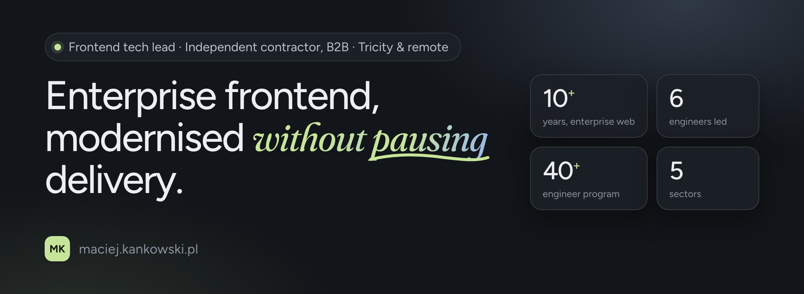

# Maciej Kankowski

Independent frontend tech lead in Gdynia, Poland. For 10+ years I have delivered enterprise web platforms on fixed-scope B2B contracts across HR, logistics, energy, finance and healthcare: technical direction, legacy modernisation to React and Node, and AI-assisted engineering workflows wired into the delivery pipeline.

**Right now:** leading a frontend chapter of six engineers and a designer inside a 40+ engineer program, for a global HR and staffing platform (client under NDA). Five frontend apps on React 19, Vite, TypeScript and Node 22, the four existing ones migrated without pausing feature delivery. A shared component library and a UX process launched, a feature-flag-first monthly release train run as release master, Claude Code rolled out policy first.

**Where I am usually called in**

- A product that got old while you were shipping it, and has to be modernised while it stays in production.
- A workstream without technical direction, where decisions get made inside pull requests instead of before them.
- AI adopted per person, not per team, and invisible in the release process.
- A release process people are afraid of.

**Stack:** React · Next.js · Vue.js · TypeScript · Vite · Node.js · CI/CD · Playwright · Cypress · multi-agent workflows · Claude Code

**Credentials:** [Claude Partner Badge – Claude Code](https://www.credly.com/badges/559dd13b-7dc9-4184-946f-346d68a0373c) · [Claude Code in Action](https://verify.skilljar.com/c/uyy2yni7bkri) · [3 × AWS Partner](https://www.credly.com/users/maciej-kankowski)

Client work lives in private repositories. What is public here is teaching material from training and mentoring programmes: [front.jit](https://github.com/mackankowski/front.jit), [frontend-guidelines](https://github.com/mackankowski/frontend-guidelines), [frontend-bootcamp](https://github.com/mackankowski/frontend-bootcamp). Side projects from 2017–2019 are archived.

[maciej.kankowski.pl](https://maciej.kankowski.pl/) · [LinkedIn](https://www.linkedin.com/in/mackankowski/) · [Credly](https://www.credly.com/users/maciej-kankowski) · [CV (PDF)](https://maciej.kankowski.pl/Maciej_Kankowski_CV.pdf) · [Contact](https://maciej.kankowski.pl/#contact)

Run a small business? My studio, [mackan studio](https://github.com/mackan-pl), does websites, apps and social media for small firms: [studio.mackan.pl](https://studio.mackan.pl/en/)
